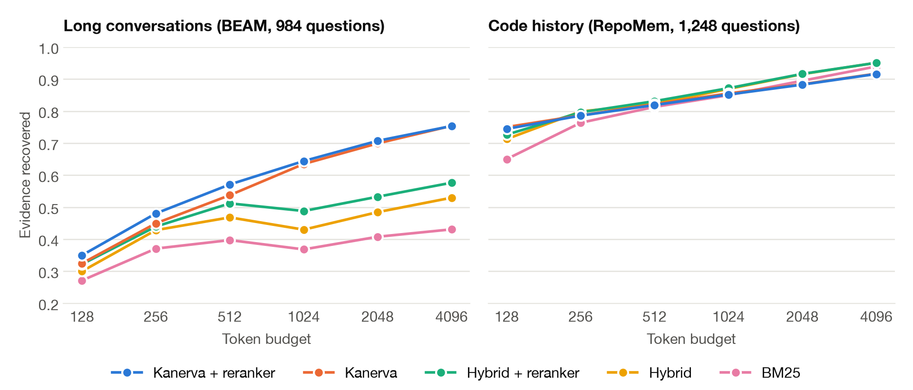

<p align="center">
  
</p>

<p align="center">
  <a href="LICENSE"></a>
  
  <a href="https://github.com/katolikov/kanerva/actions/workflows/ci.yml"></a>
  
  
  
</p>

Coding agents start every session from zero. You explain the test command again, the deploy steps again, the bug you already fixed last week. Memory tools help, but most of them paste the top few similar notes into your context, whatever those notes cost and whether or not they are still true.

**Kanerva gives your agent long-term memory that runs on your machine, makes no LLM calls, and injects only what the current step needs, under a hard token budget.**

- **Small context.** You set the budget in tokens. Kanerva picks the set of notes worth the most per token, and never goes over.
- **Facts stay current.** When a value changes, the new note supersedes the old one, so your agent stops following instructions that stopped being true.
- **Private by default.** One SQLite file in your home folder. No account, no cloud, no API key. Keys and tokens are redacted before anything is stored.
- **No extra model calls.** No LLM on write or read, so memory costs you only the tokens it injects.
- **Fits your tools.** Plugins for Claude Code and OpenCode, plus an MCP server for everything else.

## Install

You need [uv](https://docs.astral.sh/uv/) (recommended) or `python3` with NumPy.

### Claude Code

Inside Claude Code:

```text
/plugin install kanerva --marketplace katolikov/kanerva
```

Or from your shell:

```bash
claude plugin marketplace add katolikov/kanerva
claude plugin install kanerva@kanerva
```

Restart Claude Code. Memory now loads on session start and on each prompt, edits and test commands are captured as you work, and you get `/kanerva:memory`, `/kanerva:remember` and `/kanerva:forget`.

### OpenCode

```bash
curl -fsSL https://raw.githubusercontent.com/katolikov/kanerva/main/install.sh | sh -s -- opencode
```

This works on OpenCode 1.18.29 and newer, including V2. Restart OpenCode and the eight `memory_*` tools are there, with no MCP setup. On V2 you can also install it as a package:

```bash
opencode plugin add "github:katolikov/kanerva::path:plugins/opencode"
```

See the [plugin README](plugins/opencode/README.md) for details.

### Any MCP client

```bash
uv tool install git+https://github.com/katolikov/kanerva
```

```json
{
  "mcpServers": {
    "kanerva": { "command": "kanerva", "args": ["mcp"] }
  }
}
```

## What it looks like

<p align="center">
  
</p>

There is no notes file to maintain, and everything stays readable and editable with `kanerva list`, `kanerva show <id>`, `kanerva edit <id> "..."`, `kanerva forget <id>` and `kanerva export memory.md`.

## How it works

<p align="center">
  
</p>

Search engines find text that looks like your query. Kanerva also asks what is worth paying for. A small gradient-boosted model reads 30 signals for each candidate, such as how it ranked, how long it is, who said it, what sits next to it in the session and whether it mentions the entities in your question. The result is a calibrated probability that the note is needed. Selection then packs the most expected value into your token budget.

The model ships as a small JSON file and runs on NumPy in a few milliseconds, so there is no training step on your side and nothing heavy to install. Each project gets its own memory, and a `global` scope is shared across projects.

The name comes from Pentti Kanerva, whose sparse distributed memory showed how a few active bits out of many can recall what you need. It is also the idea behind the logo.

## Benchmarks

<!-- results:start -->
<picture>
  <source media="(prefers-color-scheme: dark)" srcset="docs/assets/recall-dark.png">
  
</picture>

Share of the needed evidence that made it into the context. The test data was held out: BEAM conversations and five repositories that no part of the method was fitted on, 984 and 1,248 questions. These are retrieval metrics, measured with no LLM in the loop.

| Dataset | Budget | Kanerva | Kanerva + reranker | Hybrid + reranker | Hybrid | BM25 |
|---|---:|---:|---:|---:|---:|---:|
| Long conversations | 256 | 0.449 | **0.480** | 0.439 | 0.428 | 0.371 |
| Long conversations | 1024 | 0.635 | **0.644** | 0.488 | 0.430 | 0.368 |
| Long conversations | 4096 | **0.754** | 0.753 | 0.576 | 0.529 | 0.431 |
| Code history, with keys | 256 | 0.805 | **0.809** | 0.796 | 0.799 | 0.763 |
| Code history, with keys | 1024 | 0.869 | 0.866 | **0.871** | 0.869 | 0.850 |
| Code history, with keys | 4096 | 0.926 | 0.926 | **0.951** | **0.951** | 0.939 |
| Code history, no keys | 256 | 0.786 | 0.786 | 0.796 | **0.799** | 0.763 |
| Code history, no keys | 1024 | 0.855 | 0.852 | **0.871** | 0.869 | 0.850 |
| Code history, no keys | 4096 | 0.917 | 0.916 | **0.951** | **0.951** | 0.939 |

- **Long conversations are where it shines.** Across budgets, Kanerva recovers 9 points more evidence than hybrid search with a cross-encoder reranker, and it needs no reranker to do it. At 1024 tokens it finds 0.635 of the evidence against 0.488.
- **Stale facts mostly stop.** On facts that changed, plain hybrid search injects an outdated version 100% of the time. Kanerva does so 19% of the time from text alone, and never when notes carry keys.
- **Where it loses.** On code history at large budgets, the same rule that removes stale notes also drops some useful look-alikes. At 4096 tokens without keys, Kanerva has 0.917 against 0.951 for hybrid. With five repositories the intervals are wide, so treat code-history differences of a few points as ties.

The numbers above use a small sentence-embedding model. The plugins run without one by default: lexical search alone reaches 0.546 on long conversations at 1024 tokens, and `KANERVA_EMBEDDER=static` reaches 0.592.
<!-- results:end -->

The full method, proofs and all results are in the [paper](paper/paper.pdf).

## Configuration

Everything is optional.

| Variable | Default | What it does |
|---|---|---|
| `KANERVA_EMBEDDER` | off | Set to `static` to add vector search with [model2vec](https://github.com/MinishLab/model2vec). Recommended: it raises recall and needs no GPU. Downloads a small model on first use. |
| `KANERVA_PROMPT_BUDGET` | `600` | Tokens injected per prompt. |
| `KANERVA_SESSION_BUDGET` | `400` | Tokens injected at session start. |
| `KANERVA_MIN_WEIGHT` | `0.04` | Skip notes below this probability of being needed. |
| `KANERVA_HOME` | `~/.kanerva` | Where the database lives. |
| `KANERVA_CONSOLIDATE` | off | Set to `1` to merge near-duplicate notes on compaction. Merges can be undone. |
| `KANERVA_LEARN` | off | Set to `1` to learn from which notes were used. |

## Use it as a library

```python
from kanerva import Memory

memory = Memory("memory.sqlite")
memory.write("The API timeout is 30 seconds", key="config:timeout")
memory.write("The API timeout is 60 seconds", key="config:timeout")  # supersedes the old value, keeps history
print(memory.retrieve("what is the API timeout?", budget=200).render())
```

For the best recall at small budgets, pass `reranker=CrossEncoderReranker()` with the `transformers` extra. It costs one local model call per query.

## Compared to other memory tools

| | Kanerva | Claude Code files | Mem0 | Zep / Graphiti | Letta |
|---|---|---|---|---|---|
| LLM needed on write | no | model writes the notes | yes, for fact extraction | yes | agent tool calls |
| Hard token budget | yes | 200 lines or 25 KB, unranked | no, top-k | no, top-k | block sizes |
| Handles changed facts | version chains, near-twin rule | no | LLM update or delete | bi-temporal edges | agent-managed |
| Runs without a service | yes | yes | yes, with a local vector store | needs a graph DB | server or CLI |

Those projects have things Kanerva does not, such as LLM extraction, graph traversal and hosted operation.

## Reproduce the results

```bash
make install && make data
make reproduce
make tools && make paper && make check
```

`make check` confirms that every number in the paper comes from `results/`.

## Contributing

Issues and pull requests are welcome, see [CONTRIBUTING.md](CONTRIBUTING.md). Benchmark results on your own repositories are especially useful.

## Citation

```bibtex
@misc{kanerva2026,
  title  = {Kanerva: Token-Budgeted, Validity-Aware Memory for Coding Agents, Without an LLM in the Loop},
  author = {Katolikov, Artem},
  year   = {2026},
  note   = {Preprint}
}
```

## License

[Apache-2.0](LICENSE). The LoCoMo and BEAM benchmarks have their own licenses and are downloaded when you run the experiments, not shipped here.
