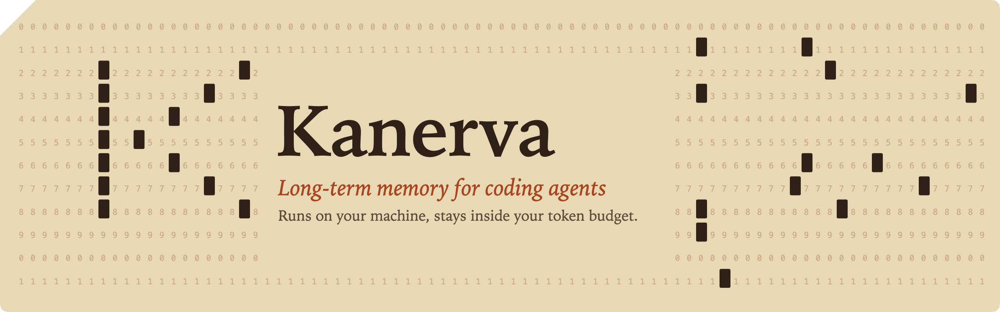
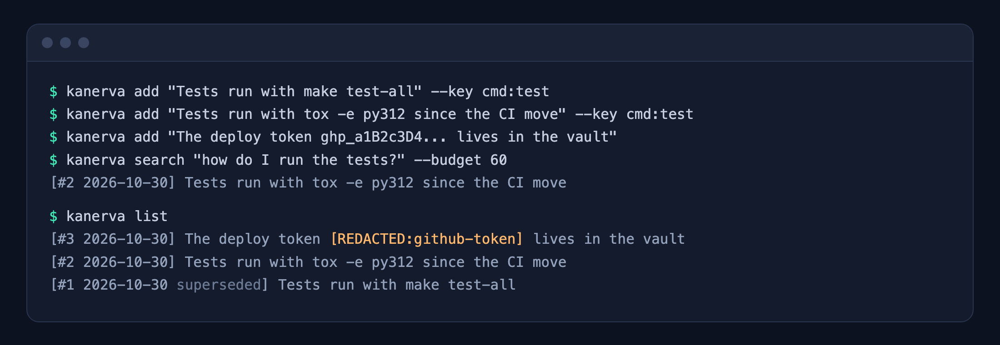
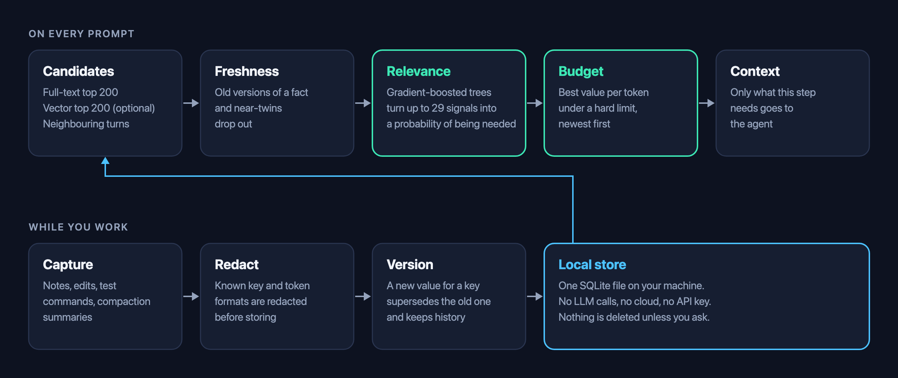
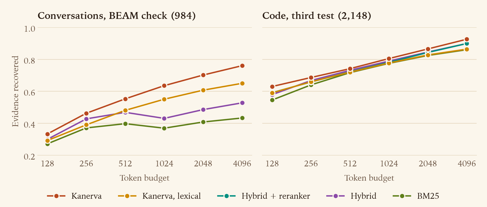

<p align="center">
  
</p>

<p align="center">
  <a href="LICENSE"></a>
  
  <a href="https://github.com/katolikov/kanerva/actions/workflows/ci.yml"></a>
</p>

Coding agents start every session from zero. You explain the test command again, the deploy steps again, the bug you already fixed last week. Memory tools help, but most of them paste the top few similar notes into your context, whatever those notes cost and whether or not they are still true.

**Kanerva gives your agent long-term memory that runs on your machine, makes no LLM calls, and injects only what the current step needs, under a hard token budget.**

- **Small context.** You set the budget in tokens, and Kanerva picks the set of notes worth the most per token. Plugins estimate tokens instead of counting them exactly, so treat the limit as close, not exact.
- **Facts stay current.** Give a fact a key, or write a near-identical note, and the new version replaces the old one. Without a key, `memory_remember` shows your agent the similar notes, and it can retire one with `memory_forget` and `replaced_by`. Old versions stay in history, and every note shows its date, newest first.
- **Quiet when it has nothing.** A gate skips prompts the store looks unable to answer, so unrelated work gets no notes.
- **Notes about the file at hand.** When a session first opens a file, the notes that name it come along.
- **Private by default.** One SQLite file in your home folder. No account, no cloud, no API key. Known key and token formats are redacted before anything is stored. The only download is the embedding model and its runtime, once, and you can turn that off.
- **No LLM of its own.** Nothing calls a model on write or read, so memory costs you the tokens it injects, plus one short turn of your own agent when a session with real work ends. You can [turn that off](#session-wrap-up).
- **Fits your tools.** Plugins for Claude Code, Codex, OpenCode, Copilot CLI and more, plus an MCP server for everything else. The [table](#install) says which ones have been run.

## Install

You need [uv](https://docs.astral.sh/uv/) (recommended) or `python3` with NumPy. Then run this with the name of your agent, or with no name to set up every supported agent it finds:

```bash
curl -fsSL https://raw.githubusercontent.com/katolikov/kanerva/main/install.sh | sh -s -- codex
```

The script runs each agent's own install commands. Agents that need local files use a clone in `~/.kanerva/src`, and run it again to update.

| Agent | Name for the script | Notes injected | `memory_*` tools | How it was checked |
|---|---|---|---:|---|
| Claude Code | `claude` | every prompt | yes | run on 2.1.314 |
| OpenCode | `opencode` | every prompt | yes | run on 1.19 and 2.2 |
| Codex | `codex` | every prompt, once you trust the hooks | yes | run on 0.166 |
| OpenClaw | `openclaw` | every prompt | yes | run on 2026.10.9 |
| Copilot CLI | `copilot` | every prompt | yes | run on 1.0.105 |
| Cursor | `cursor` | session start, then at the first tool result of a prompt | yes | docs only |
| Hermes | `hermes` | every prompt | yes, see its README | run on 0.19.0 |
| Pi | `pi` | every prompt | yes | run on 1.4.0 |
| Qwen Code | `qwen` | every prompt | yes | run on 0.26.4 |
| Devin | `devin` | every prompt | yes | docs only |
| Gemini CLI | `gemini` | every prompt | yes | run on 0.66.0 |
| Antigravity | `antigravity` | session start only | yes | docs only |
| Amp | `amp` | every prompt | no | docs, plugin load only |
| Kiro CLI | `kiro` | every prompt | yes | docs only |
| Cline CLI | `cline` | start of each run | yes | run on 3.0.74 |
| Goose, Zed | [MCP setup](plugins/mcp/README.md) | no, the agent has to ask | yes | docs only |

"Run" means a real agent session against a local stub model, with a seeded note showing up in the model's request. "Docs only" means the setup follows the agent's documentation but has not been run, so expect rough edges and please report them. The agent's README under [`plugins/`](plugins) has its details and limits.

The table is about notes on prompts. [Notes about files](#notes-about-files) are checked on fewer agents.

If you would rather use the agent's own commands:

```bash
# Claude Code
claude plugin marketplace add katolikov/kanerva
claude plugin install kanerva@kanerva

# Codex: start Codex afterwards and run /hooks, because hooks stay off until you trust them
codex plugin marketplace add katolikov/kanerva
codex plugin add kanerva@kanerva

# Copilot CLI
copilot plugin marketplace add katolikov/kanerva
copilot plugin install kanerva@kanerva

# Hermes
hermes plugins install katolikov/kanerva/plugins/hermes --enable

# OpenCode 2.x
opencode plugin add 'github:katolikov/kanerva#main::path:plugins/opencode'
```

For any other MCP client:

```bash
uv tool install 'kanerva[onnx] @ git+https://github.com/katolikov/kanerva'
```

```json
{
  "mcpServers": {
    "kanerva": { "command": "kanerva", "args": ["mcp"] }
  }
}
```

## What it looks like

<p align="center">
  
</p>

There is no notes file to maintain, and everything stays readable and editable with `kanerva list`, `kanerva show <id>`, `kanerva edit <id> "..."`, `kanerva forget <id>` and `kanerva export memory.md`.

## How it works

<p align="center">
  
</p>

Search engines find text that looks like your query. Kanerva also asks what is worth paying for. A small gradient-boosted model reads up to 29 signals for each candidate, such as how it ranked, how long it is, who said it, what sits next to it in the session and whether it mentions the entities in your question. The result is a probability that the note is needed. Selection then packs the most expected value into your token budget.

Search runs on words and on MiniLM vectors. The relevance model ships as a JSON file and runs on NumPy, so there is no training step on your side. The embedding model and ONNX Runtime arrive in the background on first use, and search stays on words until then. Each project gets its own memory, and a `global` scope is shared across projects.

Three more things happen around a prompt:

- **Changed facts.** A note with a key closes the older note with that key. Without a key, a newer near-twin replaces an older fact only if it covers your question at least as well, because facts about two neighbouring functions read alike.
- **The gate.** Before anything is injected, a small model looks at the whole result list and decides whether the store can answer this prompt at all. If not, the prompt gets no notes. Session start is not gated.
- **Notes about files.** When a session first reads or edits a file, the notes that name that file are shown, up to 150 tokens per file.

The name comes from Pentti Kanerva, whose sparse distributed memory showed how a few active bits out of many can recall what you need. It is also the idea behind the logo.

## Benchmarks

<!-- results:start -->


Share of the needed evidence that made it into the context. These are retrieval metrics, with no LLM in the loop. The one exception is the answer test at the end of this list, where a small local model reads the notes.

- **Code history** is the third held-out test: 2,148 queries over 15 repositories in Python, TypeScript, Go and Rust that nothing was fitted or tuned on, shown without keys.
- **Long conversations** are 984 questions over 55 BEAM conversations. They were never fitted on, but earlier tests saw them, so this is a check and not a test. No untouched conversation benchmark is left.

"Kanerva" is the default, with MiniLM. "Lexical" is what runs with `KANERVA_EMBEDDER=off` or until the model arrives. "Kanerva 0.4.1" is the previous release. The reranker was not rerun on BEAM.

| Dataset | Budget | Kanerva | Lexical | Kanerva 0.4.1 | Hybrid + reranker | Hybrid | BM25 |
|---|---:|---:|---:|---:|---:|---:|---:|
| Code history | 256 | **0.686** | 0.659 | 0.661 | 0.658 | 0.667 | 0.640 |
| Code history | 1024 | **0.804** | 0.777 | 0.782 | 0.781 | 0.789 | 0.774 |
| Code history | 4096 | **0.925** | 0.864 | 0.909 | 0.899 | 0.899 | 0.860 |
| Long conversations | 256 | **0.462** | 0.390 | 0.447 | n/a | 0.427 | 0.371 |
| Long conversations | 1024 | **0.635** | 0.550 | **0.635** | n/a | 0.430 | 0.369 |
| Long conversations | 4096 | 0.760 | 0.650 | **0.762** | n/a | 0.528 | 0.433 |

- **Code history.** Without keys, Kanerva leads hybrid search by 2.4 points over all budgets (interval +1.4 to +3.3), ahead on all 15 repositories, and the reranker by 2.6 points. With keys the lead over hybrid search is 2.5 points. Against 0.4.1 it gains 2.2 points without keys and 1.0 with them.
- **Each language.** Over all budgets, against hybrid search: Python 0.870 against 0.844, TypeScript 0.545 against 0.529, Go 0.523 against 0.509, Rust 0.441 against 0.425. Exact code facts are measured on Python only, because that track reads Python source.
- **C and C++.** A separate test on six repositories that nothing was tuned on, redis, curl, jq, fmt, spdlog and leveldb, with facts read by regular expressions. Without keys Kanerva leads hybrid search by 1.4 points over all budgets (interval +1.0 to +1.7, all 6 repositories) and the reranker by 0.6, though it trails the reranker at 128 tokens. On tasks at 1024 tokens it has 0.538 against 0.482. Lexical search only ties BM25, and it is weaker on C++, so let the model arrive there. Stale injection is 51.4% against 99.1% for hybrid search, and 0% with keys. File notes add 6.6 points at equal tokens. CMake, ctest, `make check` and Ninja runs count as test commands.
- **Long conversations.** 0.574 against 0.440 for hybrid search over all budgets, and 0.635 against 0.430 at 1024 tokens. The refit changed little here (+0.5 points against 0.4.1). On LoCoMo, scored out of fold, it lost a little: 0.733 to 0.726.
- **Stale facts.** At 1024 tokens on facts that changed, no outdated version got in with keys. Without keys, hybrid search injects one 99.9% of the time, Kanerva 34.9% and lexical 26.6%. A one-line keep-the-newest rule gets 36.5%, so most of this comes from a simple idea. The store alone does not detect free-text updates, so both versions get injected, newest first, until your agent fixes the older one.
- **A correction.** This page used to give 24.3% stale next to the lexical plugin default. That figure held only with MiniLM vectors. Benchmark stores held vectors even in "lexical" runs, so those rows compared near-twins by vectors, which a real lexical store does not have. The real lexical figure for 0.4.1 was 95.5% on the third test. Lexical runs now compare near-twins by hashed words, as a real store does.
- **Prompts it cannot answer.** On 12 sampled streams of the third test, the gate keeps Kanerva silent on 79.7% of questions from other repositories (58.7% lexical), where it used to speak on nearly all. This costs recall on a store's own questions: 0.657 to 0.620, or 0.591 to 0.573 lexical. Scored out of fold on the earlier TypeScript, Go and Rust repositories the cost was larger, 0.531 to 0.446. The false-alarm numbers come from foreign questions, not from real prompts that a store cannot answer.
- **Notes about files.** When a session has just opened a file of the change, file notes add 7.2 points over spending the same tokens on the prompt, on all 15 repositories. When it is still on the files of the task before, they cost 4.9 points, again on all 15. Task labels come from file overlap, which is weak and favours this feature. Adding file names to the prompt query was tested and dropped, because it hurts in the second case.
- **Changed notes without keys.** `memory_remember` lists similar notes, and your agent retires or corrects the older one. In 80 trials of Claude Code with Sonnet 5.5 on notes nothing was tuned on, it fixed 9 of 12 changed facts in its own notes about a conversation, 8 of 12 in long word-for-word turns, where it edits out the outdated part, and 16 of 16 on code facts. In an earlier round it fixed none of 8 conversation notes, and the hint, the server's instructions and the list threshold were changed after that. In 11 trials it also changed a note the labels did not mark. Reading them, most were renames, second copies of the old value or notes repeated by the new one, and one retired a signature along with a moved function, so that note survives only as history. The samples are small, and without vectors the list misses most paraphrases. An oracle that always marks the older version would take stale injection from 34.9% to 0.3%. The list costs about 150 tokens each time it appears.
- **Real prompts.** On 603 real prompts of one developer, replayed through the hooks, the gate separates far less than on the benchmarks: 53.6% of a project's own prompts get notes against 27.7% of prompts from other projects, and Russian prompts over English notes get them 37.5% of the time. The use signal behind `KANERVA_LEARN` fired on 20.5% of notes the agent never saw, so it stays off.
- **Where it loses.** Lexical search is close to level with BM25 at 512 tokens and above (+0.3 points at 512, +0.3 at 4096, and the intervals include zero). Its lead is at 128 and 256 tokens. At 1024 tokens lexical search is 0.5 points behind 0.4.1, the price of its stricter near-twin rule. Without keys Kanerva stays a little behind on exact facts (0.993 against 0.998 at 1024 tokens). It is just behind hybrid search at 256 tokens in Go and Rust, and at 128 tokens in Rust. RepoMem queries come from templates, so they favour word search, and real prompts are vaguer.
- **Answers from a local model.** Qwen3-4B answered from the notes each method selected, with no judge in the scoring. Better recall turned into better answers only weakly. On 90 fact queries from the third test, Kanerva leads BM25 by 8.5 points over 256, 512 and 1024 tokens (interval +4.5 to +14.4, all 6 repositories), the only mean to reach raw p<.05, and no test survives Holm correction. On conversations it does not beat BM25, despite far higher recall: -1.1 on LoCoMo and -4.2 on BEAM-1M, all inside their intervals. Against hybrid search it moves +6.7 on LoCoMo, +6.7 on LongMemEval-S, -4.2 on BEAM-1M, +6.3 on RepoMem, third test. An outdated value was given in 0.0% of answers at 512 tokens against 11.4% for hybrid search and 14.3% for BM25, on 35 changed facts, and a stale note in the context rarely became a stale answer. The gate saved tokens but did not stop made-up answers: 4 of 160 foreign questions without it, 4 with it, 4 for hybrid search. This reader is small and the samples are small, so read these as weak evidence, in either direction.

A query over 10,000 notes takes about 287 ms with vectors or 150 ms lexical on an M1 Pro. A hook starts a new process each time, so a prompt with 10,000 notes takes 0.72 s in all with MiniLM, 0.49 s lexical and 0.98 s with the static embedder.
<!-- results:end -->

The full method, proofs and all results are in the [paper](paper/paper.pdf).

## Configuration

Everything is optional.

| Variable | Default | What it does |
|---|---|---|
| `KANERVA_EMBEDDER` | `minilm` | `off` stays lexical and downloads nothing. `multilingual` finds notes across languages ([details](#russian-and-other-languages)). `static` uses [model2vec](https://github.com/MinishLab/model2vec), which is good for long conversational notes, worse for exact code facts, and keeps its earlier fit. Each one downloads its model on first use. |
| `KANERVA_PROMPT_BUDGET` | `600` | Tokens injected per prompt. |
| `KANERVA_SESSION_BUDGET` | `400` | Tokens injected at session start. |
| `KANERVA_FILE_BUDGET` | `150` | Tokens of notes when a session first touches a file. A session spends at most eight times this. `0` turns file notes off. |
| `KANERVA_GATE` | on | Set to `0` to inject on every prompt, even when the store looks unable to answer it. |
| `KANERVA_MIN_WEIGHT` | `0.02` | Skip notes below this estimated probability of being needed. |
| `KANERVA_HOME` | `~/.kanerva` | Where the database lives. |
| `KANERVA_CONSOLIDATE` | off | Set to `1` to merge near-duplicate notes on compaction. Merges can be undone. |
| `KANERVA_LEARN` | off | Set to `1` to scale each note by how often it was used against how often the model expected. On simulated feedback this gains a little on LoCoMo and is flat on RepoMem. On real sessions the usage signal also fires on notes the agent never saw, so this stays off. |
| `KANERVA_WRAPUP` | on | Set to `0` to stop asking your agent for a note at the end of a session. It stays off in `claude -p` and the Agent SDK, where the extra turn would replace the last message a script reads, unless set to `1`. |

### MiniLM

Kanerva runs [all-MiniLM-L6-v2](https://huggingface.co/sentence-transformers/all-MiniLM-L6-v2) on ONNX Runtime by default, with no torch. Its vectors match the ones behind the benchmarks, at a cosine above 0.9999 on samples of the benchmark texts, so the same relevance model applies.

With uv you do nothing. On first use the 90 MB model comes from the official Hugging Face repository at a pinned revision, and ONNX Runtime comes with it, all in the background. Search stays lexical until they arrive, and no hook waits for them. Hooks try `uv run --offline` first, so a hook never waits on the network either.

Without uv, a plugin needs `pip install onnxruntime tokenizers` first. An installed package needs the `onnx` extra, as in `uv tool install 'kanerva[onnx] @ git+https://github.com/katolikov/kanerva'`, and stays lexical without it. `KANERVA_EMBEDDER=off` stays lexical on purpose.

Notes written before the model arrived have no vectors. Search still finds them by their words. The download gives them vectors, and each session start does so for up to 32 notes that still lack one. To do it all at once, for example after using the static embedder:

```bash
uvx --from 'kanerva[onnx] @ git+https://github.com/katolikov/kanerva' kanerva reembed
```

### Russian and other languages

Russian notes get a Snowball stemmer, stopwords and query patterns with no setting. English behaviour does not change. On translated SQuAD paragraphs, stemming adds 5 to 7 points of recall at 512 tokens and above.

`KANERVA_EMBEDDER=multilingual` runs paraphrase-multilingual-MiniLM-L12-v2, so a Russian question finds English notes and the other way round. MiniLM stays the default, because this model is larger and slower to load and gains nothing on English. Run `kanerva reembed` after switching, or search stays on words for older notes.

### Notes about files

When a session first reads or edits a file, the hook returns the live notes that name it, newest first. On Claude Code this was checked live with a stub model, and the note reaches the model from the step after the tool call, since the hook is asynchronous. Codex accepts the same output according to its source, and it has not been run. OpenCode and Hermes hold the notes for the next request, which only unit tests cover. The other agents have not been checked.

### Session wrap-up

Only your agent knows what it tried and why, so Kanerva asks it. When a session has done real work (three file edits, one edit and a test run, or twelve shell commands), the agent gets one more turn to save a short outcome with `memory_remember`: what was tried, what worked and why. Kanerva still calls no model, but your agent's turn costs what any turn costs, and on Claude Code that can be a few model calls, because it has to load the tool first.

The note goes through the same secret filter and ranking as any other. A session is asked once, and again only after 20 more edits. A note the agent writes by itself restarts the count.

This has been run on Claude Code, Codex, OpenCode and Gemini CLI. Copilot CLI, Qwen Code, Devin and Cursor follow their hook docs and have not been run. The other agents are not asked yet. `opencode run` exits before the extra turn starts, so on OpenCode it needs the TUI or a server. Agents with the plugin's `Stop` hook now wait for it at the end of each turn, which takes about 0.2 s.

## Use it as a library

```python
from kanerva import Memory

memory = Memory("memory.sqlite")
memory.write("The API timeout is 30 seconds", key="config:timeout")
memory.write("The API timeout is 60 seconds", key="config:timeout")  # supersedes the old value, keeps history
print(memory.retrieve("what is the API timeout?", budget=200).render())
```

For the best recall at small budgets, pass `reranker=CrossEncoderReranker()` with the `transformers` extra. It costs one local model call per query.

## Compared to other memory tools

| | Kanerva | Claude Code files | Mem0 | Zep / Graphiti | Letta |
|---|---|---|---|---|---|
| LLM needed on write | no | model writes the notes | yes, for fact extraction | yes | agent tool calls |
| Hard token budget | yes | 200 lines or 25 KB, unranked | no, top-k | no, top-k | block sizes |
| Handles changed facts | version chains, near-twin rule | no | LLM update or delete | bi-temporal edges | agent-managed |
| Runs without a service | yes | yes | yes, with a local vector store | needs a graph DB | server or CLI |

Those projects have things Kanerva does not, such as LLM extraction, graph traversal and hosted operation.

## Reproduce the results

```bash
make install && make data
make reproduce
make tools && make paper && make check
```

`make check` confirms that every number in the paper comes from `results/`. The first two held-out tests are the record of the earlier method, so `make reproduce` skips them unless you name them. Each result file names the commit that produced it.

## Contributing

Issues and pull requests are welcome, see [CONTRIBUTING.md](CONTRIBUTING.md). Benchmark results on your own repositories are especially useful.

## Citation

```bibtex
@misc{kanerva2026,
  title  = {Kanerva: Token-Budgeted, Validity-Aware Memory for Coding Agents, Without an LLM in the Loop},
  author = {Katolikov, Artem},
  year   = {2026},
  note   = {Preprint}
}
```

## License

[Apache-2.0](LICENSE). The LoCoMo and BEAM benchmarks have their own licenses and are downloaded when you run the experiments, not shipped here.
